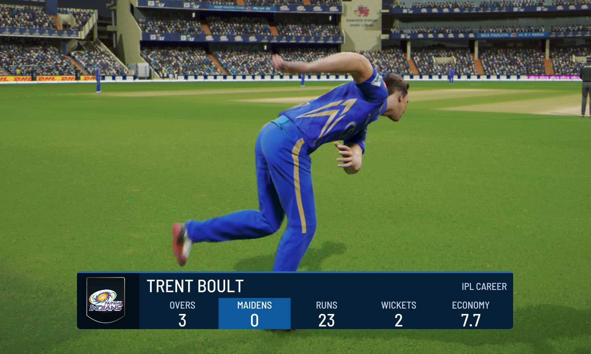
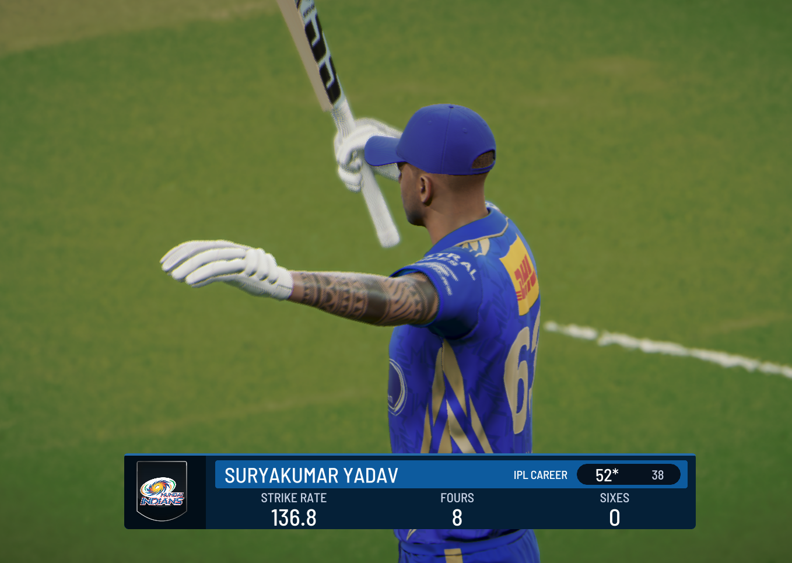
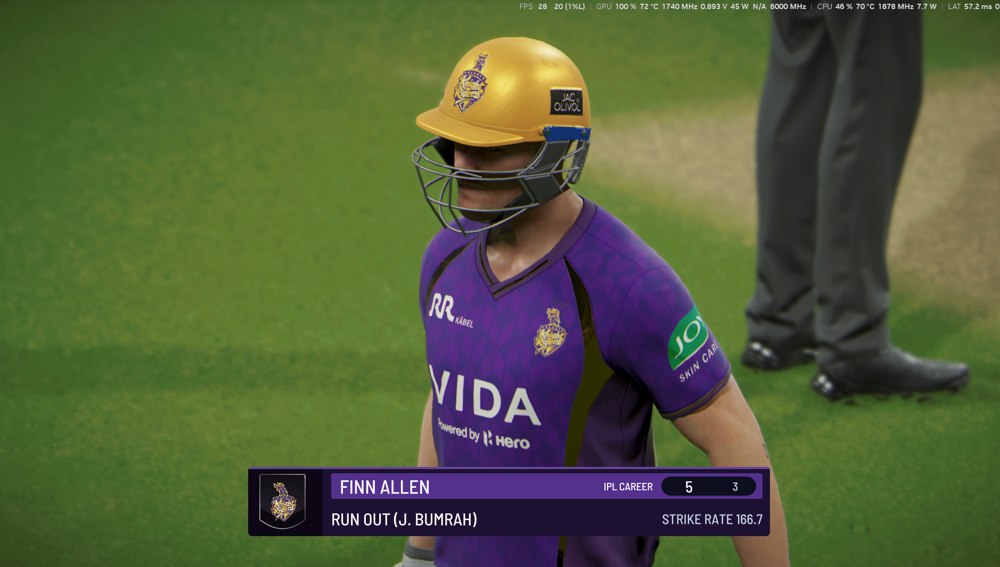

# IPL 2026 Player Cards for Cricket 26

A fan-made player-card HUD pack for **Cricket 26** (PC), designed in **Pack Studio** and installed with **Extra Cover**. It restyles the batter and bowler cards that appear during a match so they look closer to modern IPL broadcast graphics, with every card taking the colours of the team it belongs to.

> **Status: work in progress.** The bowler cards are working in game. The batter walk-in card is being fixed (see [Known issues](#known-issues)).



## What it changes

Only the player cards. The score bar and everything else in the game is left alone.

| Card | When it appears | What it shows |
|---|---|---|
| Walk-in | A new batter comes in | Name, "IPL CAREER", Matches, Runs, Strike Rate |
| Milestone | A batter reaches 50 or 100 | Name, runs and balls faced, Strike Rate, Fours, Sixes |
| Walk-off | A batter is out | Name, runs and balls faced, how out, Strike Rate |
| New bowler | A bowler's first spell | Bowler stats supplied by the game |
| Returning bowler / spell | A bowler comes back, or a spell ends | Overs, Maidens, Runs, Wickets, Economy |

**Team colours:** the card background, accent line and highlighted box follow the batting team (batter cards) or the bowling team (bowler cards), using the game's own team colour data. Text on coloured areas uses the team's own text colour so it stays readable on light kits such as yellow.

## Screenshots

<!-- Replace with your own in-game screenshots. Keep file names in sync. -->

| Walk-in | Bowler (returning / spell) |
|---|---|
|  |  |

| Milestone | Walk-off |
|---|---|
|  |  |

## Installing

1. Install [Extra Cover](https://github.com/officialasit/extracover-releases) (**version 0.4.1 or later** is required for packs built with Pack Studio 0.3.0).
2. Close Cricket 26.
3. In Extra Cover, open the **Pack library**, click **Import…** and choose the `.c26pack` file, then click **Install** on "IPL 2026 playercard".
4. Start an **International & other T20s** match.

To remove it, click **Disable mod** in Extra Cover. This restores the original files. Only one installed HUD pack can change player cards at a time.

## How it was made

1. Started from the Card Designer in Pack Studio 0.3.0 and studied IPL broadcast graphics as a style reference (layout and colour ideas only; no broadcast artwork is used).
2. Found out which stat the game supplies in each slot on each card type by building a temporary debug design that printed all seven stat slots on every card. This showed, for example, that the milestone card provides Balls, Strike Rate, Fours and Sixes rather than 50s and 100s, and that the walk-in and bowler cards use different slot orders.
3. Built the layout from rectangles, polygons and text only, using the game's live values for names and stats and team fills for colour.
4. Validated the design data against the kit's JSON schema, then tested it in the Pack Studio preview and in game.

Things I learned: the card format can't tell some card types apart (for example, new and returning bowler cards share one layout), the stat slot contents are decided by the game, and the preview and in-game rendering can differ.

## Limitations

- **No player photos.** The card format has no image layers, so there are no floating player cutouts.
- **Strike rate and economy are the game's own values.** The format has no arithmetic, so the pack cannot calculate them.
- **Balls faced** appears only where the game supplies it.
- **One shared bowler layout.** New, returning and spell bowler cards use the same five columns, so a card may show a stat set that isn't the ideal one for that moment.
- **Fonts.** The IPL's typeface is custom and not available; the pack uses the closest fonts in the game's own font list, and they may render lighter in game than in the preview.

## Known issues

- The batter walk-in card showed five stats and a lighter font in one test, instead of the intended three-stat design. Under investigation.
- Highlighted box on bowler cards sits on the second column, which is Maidens on the returning card.

## Credits and disclaimer

- Built with **[Extra Cover and Pack Studio](https://github.com/officialasit/extracover-releases)** by officialasit. These tools are proprietary; this repository does not include them.
- This is an unofficial fan project. It is **not affiliated with or endorsed by** the IPL, Big Ant Studios, Nacon or any team or sponsor.
- Team names and logos are shown by the game itself and belong to their owners. No game files, team logos or broadcast graphics are included in this repository.
- Cricket 26 is required and not included.

## Repository contents

```
README.md
screenshots/      in-game screenshots and demo video
```

<!-- Add the .c26pack or design JSON only after checking Extra Cover / Pack Studio terms. -->

## License

The text and screenshots in this repository are shared for portfolio purposes. Check the Pack Studio and Extra Cover terms before reusing the design data.
